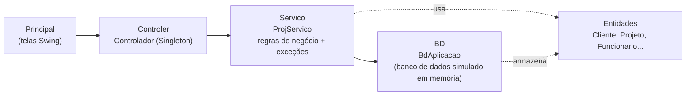
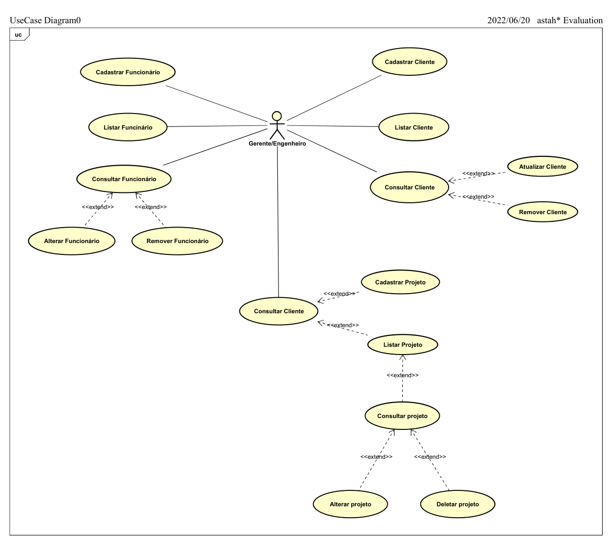
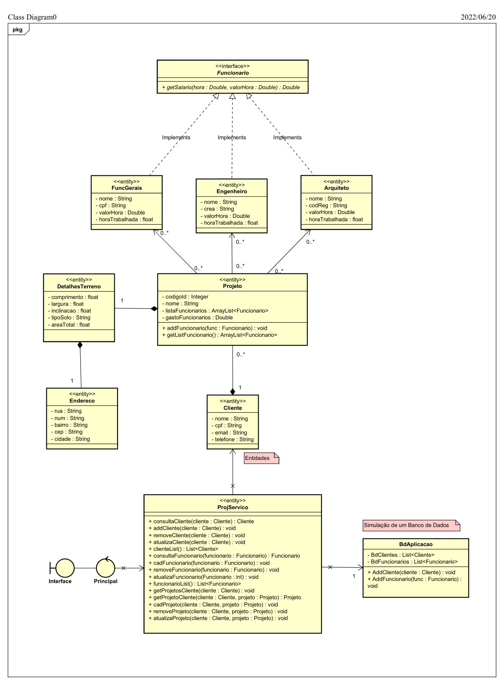
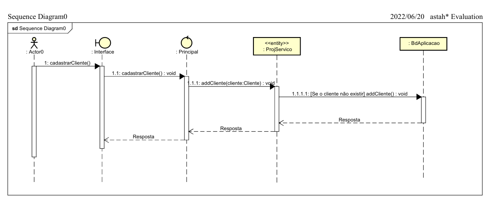
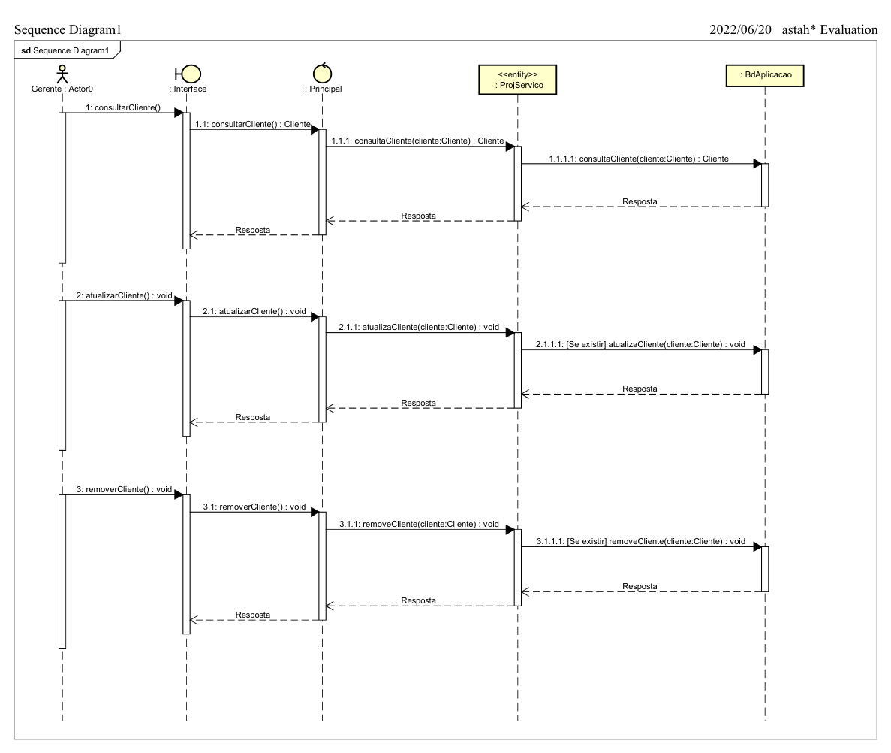
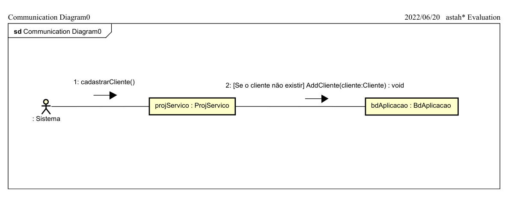
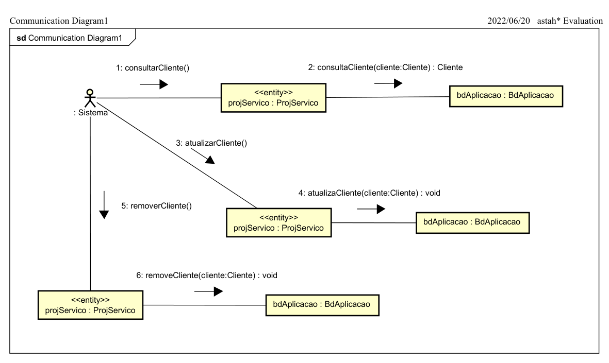

# CadProjetoEngCivil: Gerenciador de Projetos de Engenharia Civil


Sistema desktop em **Java + Swing** para cadastrar **clientes, funcionários e projetos** de uma empresa de construção civil. Foi desenvolvido no **1º semestre de 2022** como projeto da disciplina **Análise de Projeto Orientado a Objetos (AS33E)** da **UTFPR**.

> [!NOTE]
> **Projeto feito sem nenhuma ferramenta de IA.**
> O código e os diagramas UML são de **maio e junho de 2022**, meses antes do lançamento do ChatGPT (30/11/2022). Ferramentas como o GitHub Copilot também não foram usadas. Cada classe, regra de negócio e diagrama foi pensado e escrito pela equipe, com base no que aprendemos na disciplina.
>
> As datas aparecem no próprio material: os diagramas exportados do Astah trazem impressa a data `2022/06/20`, o primeiro diagrama de classes ([`DC.pdf`](DC.pdf)) é de `2022/05/29`, e o primeiro commit deste repositório usa a data real de modificação dos arquivos.

---

## Sumário

- [Sobre o projeto](#sobre-o-projeto)
- [Funcionalidades](#funcionalidades)
- [Conceitos de orientação a objetos aplicados](#conceitos-de-orientação-a-objetos-aplicados)
- [Arquitetura](#arquitetura)
- [Modelagem UML](#modelagem-uml)
- [Como executar](#como-executar)
- [Estrutura do repositório](#estrutura-do-repositório)
- [Limitações conhecidas](#limitações-conhecidas)
- [Linha do tempo](#linha-do-tempo)
- [Equipe](#equipe)

## Sobre o projeto

A disciplina pedia que cada grupo modelasse um sistema do zero, seguindo o ciclo de análise e projeto orientado a objetos:

1. **Levantamento de requisitos**: objetivos, requisitos funcionais e descrição do caso de uso ([`docs/requisitos.md`](docs/requisitos.md)).
2. **Modelagem UML** no Astah: casos de uso, diagrama de classes, diagramas de sequência e de comunicação.
3. **Implementação** em Java, seguindo o modelo.

O tema escolhido foi um **gerenciador para uma empresa de engenharia civil**. O sistema controla os clientes, os projetos de cada cliente (com dados do terreno e endereço da obra) e os profissionais alocados em cada projeto, além de calcular o custo de mão de obra.

## Funcionalidades

| Módulo | Operações |
|--------|-----------|
| **Clientes** | Cadastrar, listar, consultar por CPF, atualizar e remover |
| **Funcionários** | Cadastrar engenheiros, arquitetos e funcionários gerais; listar, consultar, atualizar e remover |
| **Projetos** | Cadastrar um projeto para um cliente, informar os detalhes do terreno (comprimento, largura, inclinação, tipo de solo, área total) e o endereço, alocar funcionários, listar, consultar, atualizar e remover |
| **Custos** | Calcular o gasto com funcionários do projeto a partir das horas trabalhadas e do valor-hora de cada cargo |

Regras de negócio validadas com **exceções próprias** (`CadException`, `AtualizaException` e `RemoveException`): não é possível cadastrar um cliente duplicado, nem atualizar ou remover um registro que não existe.

## Conceitos de orientação a objetos aplicados

- **Interface e polimorfismo**: `Funcionario` é uma interface com `getSalario()`. `Engenheiro` (identificado pelo CREA), `Arquiteto` (pelo registro) e `FuncGerais` (pelo CPF) implementam a interface, cada um com seu valor-hora. O `Projeto` soma o custo de todos os funcionários sem precisar saber o tipo de cada um.
- **Composição**: `Projeto` → `DetalhesProjeto` → `Endereco`. Os detalhes do terreno e o endereço só existem como parte de um projeto.
- **Associação**: um `Cliente` tem vários `Projeto`s, e cada projeto tem vários `Funcionario`s.
- **Encapsulamento**: atributos privados com getters e setters. O valor-hora é `final` e não pode ser alterado de fora da classe.
- **Padrão Singleton**: o `Controlador` garante uma única instância do serviço, compartilhada por todas as telas.
- **Separação em camadas**: telas, controle, regras de negócio e dados ficam em pacotes separados.
- **Exceções personalizadas** para representar erros de regra de negócio.
- **`equals` e `hashCode` sobrescritos** para comparar entidades pela identidade de negócio (CPF, código do projeto, CREA etc.).

## Arquitetura



| Pacote | Responsabilidade |
|--------|------------------|
| `Principal` | Telas Swing: menu principal e os submenus de clientes, funcionários e projetos |
| `Controler` | Ponto de acesso único ao serviço (Singleton) |
| `Servico` | Regras de negócio (cadastro, consulta, atualização e remoção) e exceções |
| `BD` | Simulação de banco de dados com listas em memória |
| `Entidades` | Modelo de domínio: `Cliente`, `Projeto`, `DetalhesProjeto`, `Endereco` e a hierarquia `Funcionario` |

## Modelagem UML

Diagramas feitos no **Astah** durante a disciplina. Os PDFs originais estão em [`docs/diagramas/pdf`](docs/diagramas/pdf) e o modelo editável está em [`docs/modelo-uml`](docs/modelo-uml).

### Diagrama de casos de uso


### Diagrama de classes


<details>
<summary><b>Diagramas de sequência</b></summary>

#### Cadastrar


#### Consultar, atualizar e remover


</details>

<details>
<summary><b>Diagramas de comunicação</b></summary>

#### Cadastrar


#### Consultar


</details>

## Como executar

**Requisitos:** JDK 18 ou superior.

### Pelo NetBeans (IDE usada no desenvolvimento)
1. Abra a pasta `ProjCadClienteEng` como projeto Maven.
2. Clique com o botão direito em `Principal/MenuPrincipal.java` e escolha **Run File**.

### Pelo terminal
```bash
cd ProjCadClienteEng
javac -encoding UTF-8 -d out $(find src/main/java -name "*.java")
java -cp out Principal.MenuPrincipal
```

> A classe principal é `Principal.MenuPrincipal`. O `exec.mainClass` do `pom.xml` ficou com o valor padrão gerado pelo NetBeans, por isso o *Run Project* não abre a aplicação diretamente.

## Estrutura do repositório

```
.
├── ProjCadClienteEng/            # Projeto Java (Maven/NetBeans)
│   └── src/main/java/
│       ├── BD/                   # Banco de dados em memória
│       ├── Controler/            # Controlador (Singleton)
│       ├── Entidades/            # Modelo de domínio
│       ├── Principal/            # Telas Swing
│       │   ├── InterfaceCliente/
│       │   ├── IntefaceFuncionario/
│       │   └── IntefaceProjeto/
│       └── Servico/              # Regras de negócio + exceções
├── docs/
│   ├── requisitos.md             # Requisitos funcionais e caso de uso
│   ├── diagramas/                # Diagramas UML (PNG + PDFs originais)
│   └── modelo-uml/               # Modelo original do Astah (.asta)
├── DC.pdf                        # Primeira versão do diagrama de classes (29/05/2022)
├── Mudanças                      # Anotações da equipe durante o desenvolvimento
└── LICENSE
```

## Limitações conhecidas

O código está publicado **exatamente como foi entregue em 2022**, sem correções posteriores, para servir de registro fiel do que fiz naquela época. Por isso, alguns pontos refletem o estágio de aprendizado:

- Os dados ficam só **em memória** (a `BdAplicacao` simula um banco de dados) e se perdem ao fechar o programa.
- A imagem do menu principal usa um caminho absoluto da máquina de um dos integrantes. Em outro computador ela não aparece, mas o resto da aplicação funciona normalmente.
- O arquivo [`Mudanças`](Mudanças) guarda as anotações de melhorias que a equipe planejava fazer.

## Linha do tempo

| Data | Marco |
|------|-------|
| **29/05/2022** | Primeira versão do diagrama de classes ([`DC.pdf`](DC.pdf)) |
| **20/06/2022** | Versão final do código, dos diagramas UML e dos documentos de requisitos |
| **2026** | Publicação neste GitHub como portfólio, sem alterações no código |

## Equipe

Grupo 6, disciplina **Análise de Projeto Orientado a Objetos (AS33E)**, UTFPR, 2022/1. Professor: Alessandro Silveira Duarte.

| Nome | Papel |
|------------|-------|
| **João Victor da Cruz Silvestre** | ([@JnetSilvestre](https://github.com/JnetSilvestre))|
| Jean Alves Rocha | Integrante |
| Matheus Muniz Ferreira | Integrante |

Distribuído sob a licença MIT ([`LICENSE`](LICENSE)).

---

<sub>Sobre este README: o código-fonte e os diagramas são originais de 2022 e não foram alterados. Só este README e a organização da pasta `docs/` foram feitos em 2026, com ajuda de IA para commit, para apresentar o projeto no portfólio.</sub>
